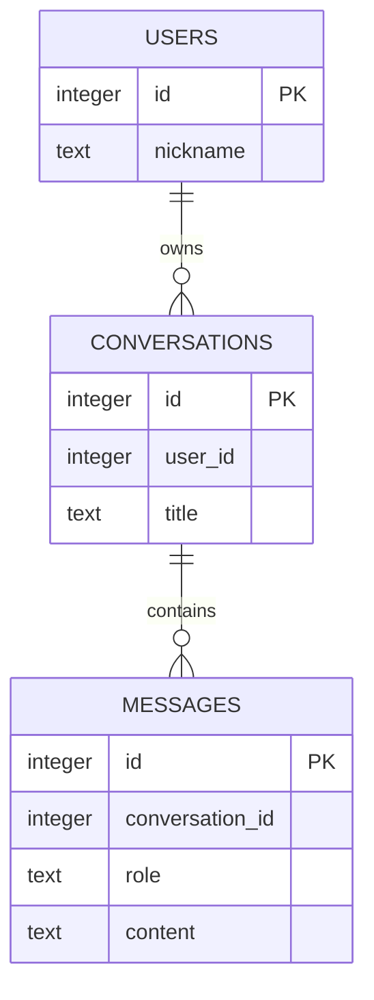

# 5차시 — 사용자·대화방·메시지 ERD와 1:N 관계 설계

**핵심 질문: 사용자 한 명이 두 번째 대화방을 만들 수 없다면 어느 규칙을 봐야 할까?**

## 오늘 할 일

- 사용자·대화방·메시지의 한 행이 뜻하는 바를 정의한다.
- 1:N 관계를 표와 샘플 데이터로 표현한다.
- 잘못된 UNIQUE가 데이터 개수를 제한하는 현상을 분석한다.

사용하는 개념: 테이블·PK·UNIQUE·INSERT·트랜잭션.
결과물: ERD·열 정의 표·수정한 UNIQUE·다중 대화방 검사 결과.

## 활동 순서

| 시간 | 활동 | 남길 기록 |
| --- | --- | --- |
| 0~5분 | 핵심 질문과 샘플 결과 예상 | 예상 상태 |
| 5~15분 | 표·SQL·함수 호출 읽기 | 규칙·호출 흐름 |
| 15~28분 | 정상·실패 실행 비교 | 실제 출력 |
| 28~40분 | Codex 분석 → 최소 수정 | 원인·변경 |
| 40~47분 | 동일 검사로 재실행 | 정상 보존·실패 처리 |
| 47~50분 | 확인 질문·제출 | 설명 |

환경 준비는 활동 전에 마친다. 선택 심화는 기본 실행에 추가하지 않는다.

## 실행 준비 — Windows CMD

Python 3.12 이상을 사용한다. 압축을 C:\kdt\KDT_SQLITE_FULL에 풀었다고 가정한다.
실제 압축 위치에 맞게 경로를 바꾼다.

```bat
cd /d C:\kdt\KDT_SQLITE_FULL\lesson_05
python --version
python -m venv .venv
.venv\Scripts\activate
python -c "import sqlite3; print('SQLite', sqlite3.sqlite_version)"
```

가상환경이 있으면 생성을 생략하고 활성화한다. 별도 pip 설치·서버·계정·키는 필요 없다.
PowerShell 활성화는 `.\.venv\Scripts\Activate.ps1`, macOS/Linux는 `source .venv/bin/activate`다.
수정한 파일을 저장하고 Python 명령을 다시 실행한다. 끝나면 `deactivate`를 실행한다.
각 실행·검사는 실제 임시 DB 파일을 사용하고 종료 때 정리한다. 앞 차시 DB 파일을 가져오지 않는다.

## 개념을 데이터와 연결하기

카페 고객 명단, 방문 주문서, 주문서의 항목을 별도 종이로 생각해 보자. 고객 한 명은 주문서를 여러 장 가질 수 있다. 주문서에 고객 번호가 등장할 때마다 유일해야 한다고 정하면 두 번째 주문서를 만들 수 없다. 대화방의 user_id도 같은 문제다.

| 요소 | 역할 |
| --- | --- |
| 엔터티 | 따로 저장할 데이터 묶음. users·conversations·messages |
| PK | 각 표의 한 행을 식별하는 id |
| 1:N | 부모 한 행과 연결된 자식 여러 행을 허용 |
| user_id | 대화방의 소유 사용자를 가리키는 값 |
| conversation_id | 메시지가 속한 대화방을 가리키는 값 |
| UNIQUE(user_id) | 사용자당 대화방을 최대 한 개로 제한하는 규칙 |

## 사용자·대화방·메시지 관계



| 표 | 한 행의 뜻 | 값으로 연결하는 열 |
| --- | --- | --- |
| users | 사용자 한 명 | id |
| conversations | 대화방 한 개 | user_id → users.id |
| messages | 메시지 한 개 | conversation_id → conversations.id |

개인별 대화방을 가정한다. 사용자 한 명은 방 여러 개, 방 하나는 메시지 여러 개를 가질 수 있다.
users는 앱에서 구분할 사용자이며 비밀번호·로그인을 구현하는 표가 아니다.
이 그림의 선은 설계 관계다. 실제 DB가 부모 존재를 강제하는지는 FOREIGN KEY와 연결 설정을 함께 확인한다.
메시지 본문을 message1·message2 열로 늘리지 않고 메시지마다 행 하나를 만든다.

### ERD를 샘플로 검증하기

| 사용자 | 대화방 | 메시지 |
| --- | --- | --- |
| 1 민지 | 10 파이썬 질문 | 1 리스트란? |
| 1 민지 | 20 SQL 질문 | 2 SQL이란? |

user_id=1이 반복되어도 대화방 id는 10·20으로 다르다. messages의 conversation_id는 해당 방을 가리킨다.
PK만 남긴 수정 후에는 사용자 1의 두 방을 모두 저장할 수 있어야 한다.
메시지 표의 한 행은 user 또는 assistant 발화 한 개다. 제목·표시 이름은 식별 키가 아니다.

## main.py 전체

```python
from pathlib import Path
import sqlite3
from tempfile import TemporaryDirectory

SCHEMA = """CREATE TABLE users (id INTEGER PRIMARY KEY, nickname TEXT NOT NULL);
CREATE TABLE conversations (
    id INTEGER PRIMARY KEY, user_id INTEGER NOT NULL UNIQUE,
    title TEXT NOT NULL
);
CREATE TABLE messages (
    id INTEGER PRIMARY KEY, conversation_id INTEGER NOT NULL,
    role TEXT NOT NULL, content TEXT NOT NULL
);"""


def create_database(db_path):
    connection = sqlite3.connect(db_path, autocommit=False)
    try:
        connection.executescript(SCHEMA)
        connection.commit()
    finally:
        connection.close()


def populate_demo(db_path):
    connection = sqlite3.connect(db_path, autocommit=False)
    try:
        connection.execute("INSERT INTO users VALUES (?, ?)", (1, "민지"))
        connection.executemany(
            "INSERT INTO conversations VALUES (?, ?, ?)",
            [(10, 1, "파이썬 질문"), (20, 1, "SQL 질문")],
        )
        connection.executemany(
            "INSERT INTO messages VALUES (?, ?, ?, ?)",
            [(1, 10, "user", "리스트란?"), (2, 20, "user", "SQL이란?")],
        )
        connection.commit()
    except sqlite3.Error:
        connection.rollback()
        raise
    finally:
        connection.close()


if __name__ == "__main__":
    with TemporaryDirectory() as folder:
        db_path = Path(folder) / "erd.db"
        create_database(db_path)
        try:
            populate_demo(db_path)
        except sqlite3.IntegrityError as exc:
            print("관계 요구사항과 충돌:", exc)
        connection = sqlite3.connect(db_path, autocommit=False)
        try:
            print("대화방:", connection.execute("SELECT * FROM conversations ORDER BY id").fetchall())
            print("메시지:", connection.execute("SELECT * FROM messages ORDER BY id").fetchall())
        finally:
            connection.close()
```

| 함수·파일 | 필요한 이유·실제 사용 |
| --- | --- |
| SCHEMA | 현재 모델의 세 표를 읽기 쉬운 SQL 문자열로 선언한다. |
| create_database | 세 표를 만들고 저장한다. 각 실행은 새 DB다. |
| populate_demo | 사용자 한 명·대화방 두 개·메시지 두 개를 하나의 입력 활동으로 저장한다. |
| check.py | 다섯 모델 사례의 저장 가능 여부와 세 표 행 수를 비교한다. |

SCHEMA가 있는 차시는 실행할 SQL 전체를 선언한 문자열이다. 선언만으로 DB에 실행되지 않는다.
create_database에서 execute 또는 executescript가 호출될 때 표가 만들어진다.
각 함수는 필요한 연결을 열고 finally에서 닫는다. 저장은 commit으로 확정하고 실패 변경은 rollback한다.
`autocommit=False`를 쓰는 코드는 Python 3.12 이상에서 실행한다.
`?`에는 별도의 값 튜플을 전달한다. 값 문자열을 SQL에 이어 붙이지 않는다.

## 예상 → 실행 → 관찰

```bat
python main.py
python check.py main
```

**시작 코드 증상:** 사용자 1이 대화방 10과 20을 만들 때 두 번째 INSERT에서 UNIQUE 오류가 나고 준비 작업이 rollback된다.

**기대 결과:** 사용자 한 명에게 대화방 두 개, 각 대화방에 메시지 한 개씩 저장되어야 한다.

check.py의 시작 결과는 `RESULT failures=1`, 종료 코드 1이다.
성공하는 정상 사례도 함께 관찰한다. 문법 오류가 없거나 commit이 있다는 사실만으로 요구사항을 만족한다고 판단하지 않는다.

## 원인 분석 → AI 수정 → 재실행 → 비교

다음 순서로 입력·SQL·결과를 따라간다.

> ERD의 사용자 1:N 대화방 → conversations.user_id 정의 → 두 번째 대화방 INSERT → UNIQUE 충돌 → rollback

CODEX_PROMPTS.md의 분석 → 최소 수정 → 검토를 사용한다.
다른 데이터나 검사 기대값을 바꾸지 않고 현재 원인만 수정한다.

```bat
python check.py main
python check.py solution
python solution.py
```

수정한 main과 비교본 solution은 **5개 검사 PASS·failures=0·종료 코드 0**이어야 한다.
CMD는 명령 직후 `echo %ERRORLEVEL%`, PowerShell은 `$LASTEXITCODE`로 종료 코드를 확인한다.
같은 입력을 다시 실행해 정상 동작과 실패 처리·기존 데이터 보존을 함께 확인한다.
최소 수정 위치와 질문 답은 직접 수정한 뒤 ANSWERS.md에서 비교한다.

## check.py 전체

```python
import argparse
from importlib import import_module
from pathlib import Path
import sqlite3
from tempfile import TemporaryDirectory


if __name__ == "__main__":
    parser = argparse.ArgumentParser()
    parser.add_argument("module", choices=["main", "solution"])
    target = import_module(parser.parse_args().module)
    cases = [
        ("one_user_many_conversations", [(1, "민지")], [(10, 1, "A"), (20, 1, "B")],
         [(1, 10, "user", "질문 A"), (2, 20, "user", "질문 B")], False, (1, 2, 2)),
        ("different_users", [(1, "민지"), (2, "준호")], [(10, 1, "A"), (20, 2, "B")], [], False, (2, 2, 0)),
        ("many_messages", [(1, "민지")], [(10, 1, "A")],
         [(1, 10, "user", "질문"), (2, 10, "assistant", "답변")], False, (1, 1, 2)),
        ("same_display_name", [(1, "민지"), (2, "민지")], [], [], False, (2, 0, 0)),
        ("duplicate_conversation_id", [(1, "민지")], [(10, 1, "A"), (10, 1, "B")], [], True, (0, 0, 0)),
    ]
    failures = 0
    with TemporaryDirectory() as folder:
        for index, (name, users, conversations, messages, expected_rejection, expected_counts) in enumerate(cases):
            db_path = Path(folder) / f"case{index}.db"
            target.create_database(db_path)
            connection = sqlite3.connect(db_path, autocommit=False)
            rejected = False
            try:
                try:
                    connection.executemany("INSERT INTO users VALUES (?, ?)", users)
                    connection.executemany("INSERT INTO conversations VALUES (?, ?, ?)", conversations)
                    connection.executemany("INSERT INTO messages VALUES (?, ?, ?, ?)", messages)
                    connection.commit()
                except sqlite3.IntegrityError:
                    connection.rollback()
                    rejected = True
                counts = tuple(connection.execute(f"SELECT COUNT(*) FROM {table}").fetchone()[0]
                               for table in ["users", "conversations", "messages"])
            finally:
                connection.close()
            passed = rejected == expected_rejection and counts == expected_counts
            print(f"{'PASS' if passed else 'FAIL'} {name}: rejected={rejected}; counts={counts}")
            failures += int(not passed)
    print(f"RESULT failures={failures}")
    raise SystemExit(1 if failures else 0)
```

검사는 main 또는 solution을 실제 import하고 함수를 호출한다.
TemporaryDirectory와 실제 .db 파일을 사용하므로 메모리 목록을 DB처럼 흉내 낸 검사가 아니다.
실패 시 거절 여부뿐 아니라 행 수·내용·참조 위반·기존 데이터 등 해당 검사의 계약을 확인한다.
표 이름을 문자열로 조합하는 검사에서는 코드에 고정된 표 이름만 사용한다. 사용자 입력을 식별자로 붙이는 방식이 아니다.

## 파일 안내

| 파일 | 역할 |
| --- | --- |
| README.md | 실행·개념·코드·관찰·제출 |
| main.py | 정상·오류 재현과 수정 |
| solution.py | 같은 목표의 최소 수정 비교본 |
| check.py | 실제 DB 파일에서 계약 검사 |
| CODEX_PROMPTS.md | 분석·수정·검토용 구체적 프롬프트 |
| ANSWERS.md | 원리·질문 답·평가 기준 |
| SOURCES.md | 공식 문서와 수업 정책 구분 |
| VERIFICATION.md | 실제 실행 출력·감사 결과·한계 |
| lesson_scope.json | 배포 전 범위 검증 자료. 실습 실행 파일 아님 |

## 오개념·막히는 지점

- 이 차시의 핵심 검사는 관계의 개수다. id 값만 가진 구조는 부모 존재를 강제하지 않는다.
- 제목·표시 이름은 식별자가 아니다. 같은 내용도 서로 다른 id의 행일 수 있다.

- 실행 후 DB 파일이 보이지 않는 것은 임시 폴더가 정리되었기 때문이다.
- autocommit 키워드 오류는 Python 버전을 확인한다. sqlite3가 없으면 사용하는 Python 배포판의 설치 상태를 확인한다.
- main.py와 solution.py를 동시에 수정하지 않는다. check.py의 기대값은 그대로 둔다.
- 전체 SQL 코드는 현재 파일의 표 정의를 기준으로 한다. 다른 차시 DB 스키마와 섞지 않는다.

## 확인 질문·제출

1. 사용자 한 명에 대화방 몇 개가 가능한가?
2. 대화방의 PK는 user_id인가?
3. user_id의 UNIQUE는 어떤 관계를 만드는가?
4. 메시지 열을 message1·message2로 만들면?
5. 같은 표시 이름 두 명은 가능한가?
6. id 값만 맞추면 없는 부모도 DB가 막는가?

제출: 수정 main.py, 수정 전후 검사 출력, 원인과 최소 수정의 관계 설명.
평가 기준과 비교 답은 ANSWERS.md에서 확인한다.

다음 학습: 외래키를 선언하고 연결별 활성화·부모 존재·삭제 정책을 검증한다.
진행 후 난이도·활동 분량·설명 깊이 피드백을 기록한다.
