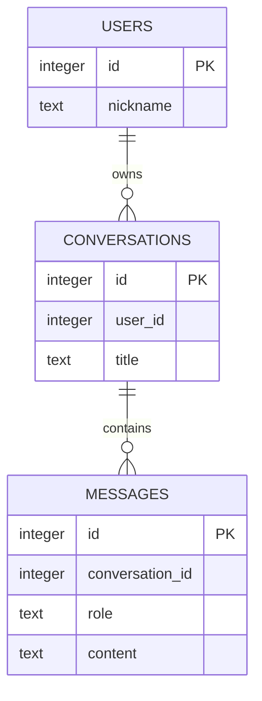

# 6차시 — 외래키로 사용자·대화방·메시지 연결 검증하기

**핵심 질문: 외래키 활성화 명령을 실행했는데 왜 부모 없는 메시지가 저장될까?**

## 오늘 할 일

- FK가 부모 행의 존재를 검사하는 원리를 설명한다.
- 외래키 설정을 트랜잭션 밖에서 연결마다 활성화한다.
- 유효한 이력 저장·없는 부모 거절·부모 삭제 제한을 비교한다.

사용하는 개념: ERD·PK·트랜잭션·rollback·제약 오류.
결과물: 수정한 연결 함수, 외래키 설정값과 여덟 검사 결과.

## 활동 순서

| 시간 | 활동 | 남길 기록 |
| --- | --- | --- |
| 0~5분 | 핵심 질문과 샘플 결과 예상 | 예상 상태 |
| 5~15분 | 표·SQL·함수 호출 읽기 | 규칙·호출 흐름 |
| 15~28분 | 정상·실패 실행 비교 | 실제 출력 |
| 28~40분 | Codex 분석 → 최소 수정 | 원인·변경 |
| 40~47분 | 동일 검사로 재실행 | 정상 보존·실패 처리 |
| 47~50분 | 확인 질문·제출 | 설명 |

환경 준비는 활동 전에 마친다. 선택 심화는 기본 실행에 추가하지 않는다.

## 실행 준비 — Windows CMD

Python 3.12 이상을 사용한다. 압축을 C:\kdt\KDT_SQLITE_FULL에 풀었다고 가정한다.
실제 압축 위치에 맞게 경로를 바꾼다.

```bat
cd /d C:\kdt\KDT_SQLITE_FULL\lesson_06
python --version
python -m venv .venv
.venv\Scripts\activate
python -c "import sqlite3; print('SQLite', sqlite3.sqlite_version)"
```

가상환경이 있으면 생성을 생략하고 활성화한다. 별도 pip 설치·서버·계정·키는 필요 없다.
PowerShell 활성화는 `.\.venv\Scripts\Activate.ps1`, macOS/Linux는 `source .venv/bin/activate`다.
수정한 파일을 저장하고 Python 명령을 다시 실행한다. 끝나면 `deactivate`를 실행한다.
각 실행·검사는 실제 임시 DB 파일을 사용하고 종료 때 정리한다. 앞 차시 DB 파일을 가져오지 않는다.

## 개념을 데이터와 연결하기

주문 항목에는 실제 있는 주문서 번호를 적어야 한다. FK는 번호가 적혀 있는지만 보는 것이 아니라 부모 주문서가 존재하는지 확인한다. 검사를 켜는 시점과 연결도 맞아야 한다.

| 요소 | 역할 |
| --- | --- |
| REFERENCES | 자식 열이 참조할 부모 표의 PK 지정 |
| PRAGMA foreign_keys = ON | 해당 연결의 외래키 검사를 활성화 |
| autocommit=True | 외래키 설정 동안 열린 트랜잭션이 없도록 연결 |
| connection.autocommit = False | 설정 후 일반 업무를 명시 commit·rollback 방식으로 전환 |
| ON DELETE RESTRICT | 자식 행이 남은 부모 삭제를 거절 |
| PRAGMA foreign_key_check | 실제 참조 위반 행이 있는지 검사 |

## 사용자·대화방·메시지 관계



| 표 | 한 행의 뜻 | 값으로 연결하는 열 |
| --- | --- | --- |
| users | 사용자 한 명 | id |
| conversations | 대화방 한 개 | user_id → users.id |
| messages | 메시지 한 개 | conversation_id → conversations.id |

개인별 대화방을 가정한다. 사용자 한 명은 방 여러 개, 방 하나는 메시지 여러 개를 가질 수 있다.
users는 앱에서 구분할 사용자이며 비밀번호·로그인을 구현하는 표가 아니다.
이 그림의 선은 설계 관계다. 실제 DB가 부모 존재를 강제하는지는 FOREIGN KEY와 연결 설정을 함께 확인한다.
메시지 본문을 message1·message2 열로 늘리지 않고 메시지마다 행 하나를 만든다.

### FK와 삭제 정책

```sql
user_id INTEGER NOT NULL REFERENCES users(id) ON DELETE RESTRICT
conversation_id INTEGER NOT NULL REFERENCES conversations(id) ON DELETE RESTRICT
```

삭제를 막는 RESTRICT 정책을 사용한다. 자식이 남아 있으면 부모 삭제를 거절한다.
자동 연쇄 삭제로 오해하지 않는다. 고아 삽입을 막는 검사와 부모 삭제 정책을 각각 확인한다.
정상 준비 데이터는 사용자 1 → 대화방 10 → 메시지 1이다.

## main.py 전체

```python
from pathlib import Path
import sqlite3
from tempfile import TemporaryDirectory

SCHEMA = """CREATE TABLE users (id INTEGER PRIMARY KEY, nickname TEXT NOT NULL);
CREATE TABLE conversations (
    id INTEGER PRIMARY KEY,
    user_id INTEGER NOT NULL REFERENCES users(id) ON DELETE RESTRICT,
    title TEXT NOT NULL
);
CREATE TABLE messages (
    id INTEGER PRIMARY KEY,
    conversation_id INTEGER NOT NULL REFERENCES conversations(id) ON DELETE RESTRICT,
    role TEXT NOT NULL CHECK(role IN ('user', 'assistant')),
    content TEXT NOT NULL
);"""

def connect_database(db_path):
    connection = sqlite3.connect(db_path, autocommit=False)
    connection.execute("PRAGMA foreign_keys = ON")
    return connection


def create_database(db_path):
    connection = connect_database(db_path)
    try:
        connection.executescript(SCHEMA)
        connection.execute("INSERT INTO users VALUES (1, '민지')")
        connection.execute("INSERT INTO conversations VALUES (10, 1, 'SQL 질문')")
        connection.execute("INSERT INTO messages VALUES (1, 10, 'user', '안녕')")
        connection.commit()
    finally:
        connection.close()


if __name__ == "__main__":
    with TemporaryDirectory() as folder:
        db_path = Path(folder) / "foreign_keys.db"
        create_database(db_path)
        connection = connect_database(db_path)
        try:
            print("외래키 설정:", connection.execute("PRAGMA foreign_keys").fetchone()[0])
            try:
                connection.execute("INSERT INTO messages VALUES (?, ?, ?, ?)", (2, 999, "user", "고아 메시지"))
                connection.commit()
            except sqlite3.IntegrityError as exc:
                connection.rollback()
                print("없는 대화방 거절:", exc)
            else:
                print("문제: 없는 대화방의 메시지가 저장되었습니다.")
        finally:
            connection.close()
```

| 함수·파일 | 필요한 이유·실제 사용 |
| --- | --- |
| connect_database | 이 차시의 연결 생성·설정 시점을 한 곳에서 확인한다. |
| create_database | 사용자 1·대화방 10·메시지 1을 준비한다. |
| main 직접 실행 | 설정값을 읽고 없는 대화방 메시지의 거절 여부를 관찰한다. |
| check.py | 정상·두 종류 고아·두 부모 삭제·역할·NULL·설정값을 검사한다. |

SCHEMA가 있는 차시는 실행할 SQL 전체를 선언한 문자열이다. 선언만으로 DB에 실행되지 않는다.
create_database에서 execute 또는 executescript가 호출될 때 표가 만들어진다.
각 함수는 필요한 연결을 열고 finally에서 닫는다. 저장은 commit으로 확정하고 실패 변경은 rollback한다.
`autocommit=False`를 쓰는 코드는 Python 3.12 이상에서 실행한다.
`?`에는 별도의 값 튜플을 전달한다. 값 문자열을 SQL에 이어 붙이지 않는다.

## 예상 → 실행 → 관찰

```bat
python main.py
python check.py main
```

**시작 코드 증상:** 외래키 설정이 0이고 conversation_id=999인 고아 메시지가 commit된다.

**기대 결과:** 설정값은 1이며 없는 대화방·사용자의 자식 삽입과 자식이 있는 부모 삭제가 거절되어야 한다.

check.py의 시작 결과는 `RESULT failures=5`, 종료 코드 1이다.
성공하는 정상 사례도 함께 관찰한다. 문법 오류가 없거나 commit이 있다는 사실만으로 요구사항을 만족한다고 판단하지 않는다.

## 원인 분석 → AI 수정 → 재실행 → 비교

다음 순서로 입력·SQL·결과를 따라간다.

> connect_database → autocommit=False가 여는 트랜잭션 → PRAGMA ON의 적용 여부 → 새 연결 INSERT → foreign_key_check

CODEX_PROMPTS.md의 분석 → 최소 수정 → 검토를 사용한다.
다른 데이터나 검사 기대값을 바꾸지 않고 현재 원인만 수정한다.

```bat
python check.py main
python check.py solution
python solution.py
```

수정한 main과 비교본 solution은 **8개 검사 PASS·failures=0·종료 코드 0**이어야 한다.
CMD는 명령 직후 `echo %ERRORLEVEL%`, PowerShell은 `$LASTEXITCODE`로 종료 코드를 확인한다.
같은 입력을 다시 실행해 정상 동작과 실패 처리·기존 데이터 보존을 함께 확인한다.
최소 수정 위치와 질문 답은 직접 수정한 뒤 ANSWERS.md에서 비교한다.

## check.py 전체

```python
import argparse
from importlib import import_module
from pathlib import Path
import sqlite3
from tempfile import TemporaryDirectory


if __name__ == "__main__":
    parser = argparse.ArgumentParser()
    parser.add_argument("module", choices=["main", "solution"])
    target = import_module(parser.parse_args().module)
    cases = [
        ("valid_message", "INSERT INTO messages VALUES (?, ?, ?, ?)", (2, 10, "assistant", "답변"), False),
        ("missing_conversation", "INSERT INTO messages VALUES (?, ?, ?, ?)", (2, 999, "user", "질문"), True),
        ("missing_user", "INSERT INTO conversations VALUES (?, ?, ?)", (20, 999, "대화"), True),
        ("parent_conversation_delete", "DELETE FROM conversations WHERE id = ?", (10,), True),
        ("parent_user_delete", "DELETE FROM users WHERE id = ?", (1,), True),
        ("invalid_role", "INSERT INTO messages VALUES (?, ?, ?, ?)", (2, 10, "admin", "질문"), True),
        ("null_content", "INSERT INTO messages VALUES (?, ?, ?, ?)", (2, 10, "user", None), True),
    ]
    failures = 0
    with TemporaryDirectory() as folder:
        for index, (name, sql, params, expected_rejection) in enumerate(cases):
            db_path = Path(folder) / f"case{index}.db"
            target.create_database(db_path)
            connection = target.connect_database(db_path)
            try:
                if index == 0:
                    enabled = connection.execute("PRAGMA foreign_keys").fetchone()[0] == 1
                    print(f"{'PASS' if enabled else 'FAIL'} foreign_keys_enabled")
                    failures += int(not enabled)
                rejected = False
                try:
                    connection.execute(sql, params)
                    connection.commit()
                except sqlite3.IntegrityError:
                    connection.rollback()
                    rejected = True
                violations = connection.execute("PRAGMA foreign_key_check").fetchall()
            finally:
                connection.close()
            passed = rejected == expected_rejection and violations == []
            print(f"{'PASS' if passed else 'FAIL'} {name}: rejected={rejected}; violations={violations}")
            failures += int(not passed)
    print(f"RESULT failures={failures}")
    raise SystemExit(1 if failures else 0)
```

검사는 main 또는 solution을 실제 import하고 함수를 호출한다.
TemporaryDirectory와 실제 .db 파일을 사용하므로 메모리 목록을 DB처럼 흉내 낸 검사가 아니다.
실패 시 거절 여부뿐 아니라 행 수·내용·참조 위반·기존 데이터 등 해당 검사의 계약을 확인한다.
표 이름을 문자열로 조합하는 검사에서는 코드에 고정된 표 이름만 사용한다. 사용자 입력을 식별자로 붙이는 방식이 아니다.

## 파일 안내

| 파일 | 역할 |
| --- | --- |
| README.md | 실행·개념·코드·관찰·제출 |
| main.py | 정상·오류 재현과 수정 |
| solution.py | 같은 목표의 최소 수정 비교본 |
| check.py | 실제 DB 파일에서 계약 검사 |
| CODEX_PROMPTS.md | 분석·수정·검토용 구체적 프롬프트 |
| ANSWERS.md | 원리·질문 답·평가 기준 |
| SOURCES.md | 공식 문서와 수업 정책 구분 |
| VERIFICATION.md | 실제 실행 출력·감사 결과·한계 |
| lesson_scope.json | 배포 전 범위 검증 자료. 실습 실행 파일 아님 |

## 오개념·막히는 지점

- 잘못된 연결에서 만들어진 고아 데이터는 설정을 고쳤다고 자동 삭제되지 않는다. 각 검사는 새 DB에서 시작한다.
- foreign_key_check 결과와 foreign_keys 설정값은 서로 다른 확인 항목이다.

- 실행 후 DB 파일이 보이지 않는 것은 임시 폴더가 정리되었기 때문이다.
- autocommit 키워드 오류는 Python 버전을 확인한다. sqlite3가 없으면 사용하는 Python 배포판의 설치 상태를 확인한다.
- main.py와 solution.py를 동시에 수정하지 않는다. check.py의 기대값은 그대로 둔다.
- 전체 SQL 코드는 현재 파일의 표 정의를 기준으로 한다. 다른 차시 DB 스키마와 섞지 않는다.

## 확인 질문·제출

1. FK는 어떤 사실을 보장하는가?
2. PRAGMA는 한 번만 켜면 모든 연결에 적용되는가?
3. 트랜잭션 안에서 켜면?
4. 왜 True 다음 False로 바꾸는가?
5. RESTRICT는 자동 연쇄 삭제인가?
6. PRAGMA foreign_key_check 결과 []는?

제출: 수정 main.py, 수정 전후 검사 출력, 원인과 최소 수정의 관계 설명.
평가 기준과 비교 답은 ANSWERS.md에서 확인한다.

다음 학습: JOIN으로 표를 연결하고 대화방별 메시지 수와 이력을 조회한다.
진행 후 난이도·활동 분량·설명 깊이 피드백을 기록한다.
