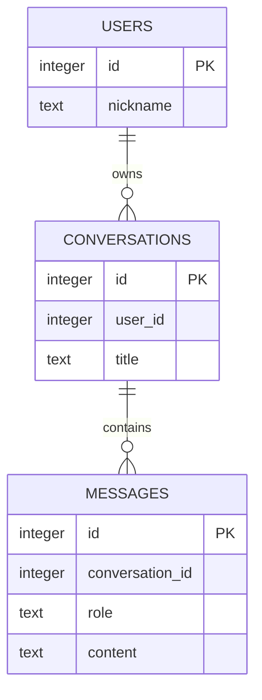

# 7차시 — JOIN·GROUP BY로 대화 목록과 메시지 이력 조회하기

**핵심 질문: 메시지가 없는 대화방에 메시지 수 1이 표시되는 이유는 무엇일까?**

## 오늘 할 일

- JOIN으로 사용자·대화방·메시지 정보를 연결한다.
- LEFT JOIN으로 비어 있는 대화방도 목록에 남긴다.
- COUNT(*)와 COUNT(열)의 차이로 빈 대화방을 0개로 집계한다.

사용하는 개념: FK·SELECT·WHERE·ORDER BY·빈 결과.
결과물: 대화 목록 집계 SQL과 이력 출력, 일곱 검사 결과.

## 활동 순서

| 시간 | 활동 | 남길 기록 |
| --- | --- | --- |
| 0~5분 | 핵심 질문과 샘플 결과 예상 | 예상 상태 |
| 5~15분 | 표·SQL·함수 호출 읽기 | 규칙·호출 흐름 |
| 15~28분 | 정상·실패 실행 비교 | 실제 출력 |
| 28~40분 | Codex 분석 → 최소 수정 | 원인·변경 |
| 40~47분 | 동일 검사로 재실행 | 정상 보존·실패 처리 |
| 47~50분 | 확인 질문·제출 | 설명 |

환경 준비는 활동 전에 마친다. 선택 심화는 기본 실행에 추가하지 않는다.

## 실행 준비 — Windows CMD

Python 3.12 이상을 사용한다. 압축을 C:\kdt\KDT_SQLITE_FULL에 풀었다고 가정한다.
실제 압축 위치에 맞게 경로를 바꾼다.

```bat
cd /d C:\kdt\KDT_SQLITE_FULL\lesson_07
python --version
python -m venv .venv
.venv\Scripts\activate
python -c "import sqlite3; print('SQLite', sqlite3.sqlite_version)"
```

가상환경이 있으면 생성을 생략하고 활성화한다. 별도 pip 설치·서버·계정·키는 필요 없다.
PowerShell 활성화는 `.\.venv\Scripts\Activate.ps1`, macOS/Linux는 `source .venv/bin/activate`다.
수정한 파일을 저장하고 Python 명령을 다시 실행한다. 끝나면 `deactivate`를 실행한다.
각 실행·검사는 실제 임시 DB 파일을 사용하고 종료 때 정리한다. 앞 차시 DB 파일을 가져오지 않는다.

## 개념을 데이터와 연결하기

카페 주문서 목록에 주문 항목을 붙인다. 아직 항목이 없는 주문서도 보여주려면 주문서를 기준으로 남겨야 한다. 붙인 결과에 빈 자리 한 줄이 있다고 실제 주문 항목이 한 개 있는 것은 아니다.

| 요소 | 역할 |
| --- | --- |
| JOIN users | 대화방의 사용자 번호로 닉네임 연결 |
| LEFT JOIN messages | 메시지가 없는 대화방도 유지 |
| GROUP BY | 대화방 단위로 묶기 |
| COUNT(*) | 결합 결과의 행 수 계산 |
| COUNT(m.id) | NULL이 아닌 실제 메시지 id만 계산 |
| ORDER BY m.id | 삽입 id 순으로 이력 표시 |

## 사용자·대화방·메시지 관계



| 표 | 한 행의 뜻 | 값으로 연결하는 열 |
| --- | --- | --- |
| users | 사용자 한 명 | id |
| conversations | 대화방 한 개 | user_id → users.id |
| messages | 메시지 한 개 | conversation_id → conversations.id |

개인별 대화방을 가정한다. 사용자 한 명은 방 여러 개, 방 하나는 메시지 여러 개를 가질 수 있다.
users는 앱에서 구분할 사용자이며 비밀번호·로그인을 구현하는 표가 아니다.
이 그림의 선은 설계 관계다. 실제 DB가 부모 존재를 강제하는지는 FOREIGN KEY와 연결 설정을 함께 확인한다.
메시지 본문을 message1·message2 열로 늘리지 않고 메시지마다 행 하나를 만든다.

### LEFT JOIN 결과를 직접 예상하기

| 방 id | 제목 | 실제 메시지 id | 목표 개수 |
| --- | --- | --- | --- |
| 10 | 빈 대화 | 없음 | 0 |
| 20 | 파이썬 | 1, 2 | 2 |
| 30 | SQL | 3 | 1 |

LEFT JOIN의 빈 대화방 행에서 메시지 열은 NULL이다. `COUNT(*)`와 `COUNT(m.id)`에 무엇이 들어가는지 써 본다.
단순히 INNER JOIN으로 바꾸면 빈 방을 숨겨 버리므로 해결이 아니다.
이력의 id 정렬은 이 실습의 저장 순서다. 실제 외부 발화 시각·동시성의 완전한 시간 순서를 보장하지 않는다.

## main.py 전체

```python
from pathlib import Path
import sqlite3
from tempfile import TemporaryDirectory

SCHEMA = """CREATE TABLE users (id INTEGER PRIMARY KEY, nickname TEXT NOT NULL);
CREATE TABLE conversations (
    id INTEGER PRIMARY KEY,
    user_id INTEGER NOT NULL REFERENCES users(id) ON DELETE RESTRICT,
    title TEXT NOT NULL
);
CREATE TABLE messages (
    id INTEGER PRIMARY KEY,
    conversation_id INTEGER NOT NULL REFERENCES conversations(id) ON DELETE RESTRICT,
    role TEXT NOT NULL CHECK(role IN ('user', 'assistant')),
    content TEXT NOT NULL
);"""

def connect_database(db_path):
    connection = sqlite3.connect(db_path, autocommit=True)
    connection.execute("PRAGMA foreign_keys = ON")
    connection.autocommit = False
    return connection


def create_database(db_path):
    connection = connect_database(db_path)
    try:
        connection.executescript(SCHEMA)
        connection.executemany("INSERT INTO users VALUES (?, ?)", [(1, "민지"), (2, "준호")])
        connection.executemany("INSERT INTO conversations VALUES (?, ?, ?)",
                               [(10, 1, "빈 대화"), (20, 1, "파이썬"), (30, 2, "SQL")])
        connection.executemany("INSERT INTO messages VALUES (?, ?, ?, ?)",
                               [(1, 20, "user", "질문"), (2, 20, "assistant", "답변"), (3, 30, "user", "SQL 질문")])
        connection.commit()
    finally:
        connection.close()


def conversation_summary(db_path, user_id):
    connection = connect_database(db_path)
    try:
        return connection.execute(
            "SELECT c.id, u.nickname, c.title, COUNT(*) AS message_count "
            "FROM conversations AS c JOIN users AS u ON u.id = c.user_id "
            "LEFT JOIN messages AS m ON m.conversation_id = c.id "
            "WHERE c.user_id = ? "
            "GROUP BY c.id, u.nickname, c.title ORDER BY c.id", (user_id,)
        ).fetchall()
    finally:
        connection.close()


def message_history(db_path, conversation_id):
    connection = connect_database(db_path)
    try:
        return connection.execute(
            "SELECT m.id, m.role, m.content FROM messages AS m "
            "JOIN conversations AS c ON c.id = m.conversation_id "
            "WHERE c.id = ? ORDER BY m.id", (conversation_id,)
        ).fetchall()
    finally:
        connection.close()


if __name__ == "__main__":
    with TemporaryDirectory() as folder:
        db_path = Path(folder) / "joins.db"
        create_database(db_path)
        print("사용자 1 대화 목록:", conversation_summary(db_path, 1))
        print("대화 20 이력:", message_history(db_path, 20))
        print("빈 대화 이력:", message_history(db_path, 10))
```

| 함수·파일 | 필요한 이유·실제 사용 |
| --- | --- |
| create_database | 사용자 둘·대화방 셋·메시지 셋의 고정 명단을 만든다. |
| conversation_summary | 사용자 조건으로 닉네임·제목·메시지 개수를 조회한다. |
| message_history | 지정 대화방의 발화 역할·본문을 id 순으로 읽는다. |
| check.py | 빈 대화방·타 사용자 목록·없는 대상·이력 순서·문자열 값 전달을 비교한다. |

SCHEMA가 있는 차시는 실행할 SQL 전체를 선언한 문자열이다. 선언만으로 DB에 실행되지 않는다.
create_database에서 execute 또는 executescript가 호출될 때 표가 만들어진다.
각 함수는 필요한 연결을 열고 finally에서 닫는다. 저장은 commit으로 확정하고 실패 변경은 rollback한다.
`autocommit=False`를 쓰는 코드는 Python 3.12 이상에서 실행한다.
`?`에는 별도의 값 튜플을 전달한다. 값 문자열을 SQL에 이어 붙이지 않는다.

## 예상 → 실행 → 관찰

```bat
python main.py
python check.py main
```

**시작 코드 증상:** 사용자 1의 빈 대화방 10의 message_count가 1이다. 메시지 두 개가 있는 방 20은 정상 2다.

**기대 결과:** 사용자 1 목록은 빈 대화방 0개·파이썬 방 2개, 사용자 2는 SQL 방 1개여야 한다.

check.py의 시작 결과는 `RESULT failures=1`, 종료 코드 1이다.
성공하는 정상 사례도 함께 관찰한다. 문법 오류가 없거나 commit이 있다는 사실만으로 요구사항을 만족한다고 판단하지 않는다.

## 원인 분석 → AI 수정 → 재실행 → 비교

다음 순서로 입력·SQL·결과를 따라간다.

> conversations → LEFT JOIN messages → 일치 메시지 없는 NULL 확장 행 → GROUP BY → COUNT(*)

CODEX_PROMPTS.md의 분석 → 최소 수정 → 검토를 사용한다.
다른 데이터나 검사 기대값을 바꾸지 않고 현재 원인만 수정한다.

```bat
python check.py main
python check.py solution
python solution.py
```

수정한 main과 비교본 solution은 **7개 검사 PASS·failures=0·종료 코드 0**이어야 한다.
CMD는 명령 직후 `echo %ERRORLEVEL%`, PowerShell은 `$LASTEXITCODE`로 종료 코드를 확인한다.
같은 입력을 다시 실행해 정상 동작과 실패 처리·기존 데이터 보존을 함께 확인한다.
최소 수정 위치와 질문 답은 직접 수정한 뒤 ANSWERS.md에서 비교한다.

## check.py 전체

```python
import argparse
from importlib import import_module
from pathlib import Path
from tempfile import TemporaryDirectory


if __name__ == "__main__":
    parser = argparse.ArgumentParser()
    parser.add_argument("module", choices=["main", "solution"])
    target = import_module(parser.parse_args().module)
    with TemporaryDirectory() as folder:
        db_path = Path(folder) / "check.db"
        target.create_database(db_path)
        checks = [
            ("empty_conversation_count_zero", target.conversation_summary(db_path, 1),
             [(10, "민지", "빈 대화", 0), (20, "민지", "파이썬", 2)]),
            ("other_user_summary", target.conversation_summary(db_path, 2), [(30, "준호", "SQL", 1)]),
            ("missing_user", target.conversation_summary(db_path, 999), []),
            ("ordered_history", target.message_history(db_path, 20), [(1, "user", "질문"), (2, "assistant", "답변")]),
            ("empty_history", target.message_history(db_path, 10), []),
            ("missing_history", target.message_history(db_path, 999), []),
            ("sql_text_is_value", target.conversation_summary(db_path, "1 OR 1=1"), []),
        ]
    failures = 0
    for name, actual, expected in checks:
        passed = actual == expected
        print(f"{'PASS' if passed else 'FAIL'} {name}: actual={actual}; expected={expected}")
        failures += int(not passed)
    print(f"RESULT failures={failures}")
    raise SystemExit(1 if failures else 0)
```

검사는 main 또는 solution을 실제 import하고 함수를 호출한다.
TemporaryDirectory와 실제 .db 파일을 사용하므로 메모리 목록을 DB처럼 흉내 낸 검사가 아니다.
실패 시 거절 여부뿐 아니라 행 수·내용·참조 위반·기존 데이터 등 해당 검사의 계약을 확인한다.
표 이름을 문자열로 조합하는 검사에서는 코드에 고정된 표 이름만 사용한다. 사용자 입력을 식별자로 붙이는 방식이 아니다.

## 파일 안내

| 파일 | 역할 |
| --- | --- |
| README.md | 실행·개념·코드·관찰·제출 |
| main.py | 정상·오류 재현과 수정 |
| solution.py | 같은 목표의 최소 수정 비교본 |
| check.py | 실제 DB 파일에서 계약 검사 |
| CODEX_PROMPTS.md | 분석·수정·검토용 구체적 프롬프트 |
| ANSWERS.md | 원리·질문 답·평가 기준 |
| SOURCES.md | 공식 문서와 수업 정책 구분 |
| VERIFICATION.md | 실제 실행 출력·감사 결과·한계 |
| lesson_scope.json | 배포 전 범위 검증 자료. 실습 실행 파일 아님 |

## 오개념·막히는 지점

- 물리적인 DB 처리 순서를 설명하는 것이 아니라 쿼리 의미를 따라가며 결과를 분석한다.
- 현재 이력 조회는 대화방 id 기준이다. 호출자의 신원 검증 기능이 있는 것으로 설명하지 않는다.

- 실행 후 DB 파일이 보이지 않는 것은 임시 폴더가 정리되었기 때문이다.
- autocommit 키워드 오류는 Python 버전을 확인한다. sqlite3가 없으면 사용하는 Python 배포판의 설치 상태를 확인한다.
- main.py와 solution.py를 동시에 수정하지 않는다. check.py의 기대값은 그대로 둔다.
- 전체 SQL 코드는 현재 파일의 표 정의를 기준으로 한다. 다른 차시 DB 스키마와 섞지 않는다.

## 확인 질문·제출

1. INNER JOIN만 메시지에 적용하면?
2. LEFT JOIN의 부모 행은?
3. COUNT(*)와 COUNT(m.id)의 차이는?
4. GROUP BY는 무엇을 기준으로 묶는가?
5. 이력에서 id 순서의 의미는?
6. user_id 필터가 실제 로그인 인증인가?

제출: 수정 main.py, 수정 전후 검사 출력, 원인과 최소 수정의 관계 설명.
평가 기준과 비교 답은 ANSWERS.md에서 확인한다.

다음 학습: 저장·조회 함수를 모듈로 사용하고 대화방 소유 조건과 실패 시 원복을 회귀 검사한다.
진행 후 난이도·활동 분량·설명 깊이 피드백을 기록한다.
