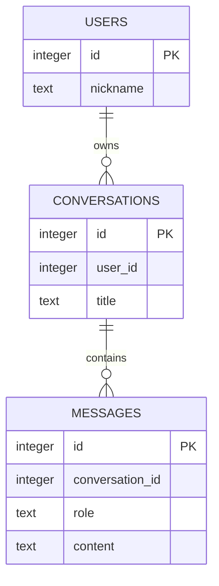

# 8차시 — 대화 이력 저장 모듈과 정상·실패 회귀 검사

**핵심 질문: 저장은 소유자를 검사하는데 조회는 왜 다른 사람의 방도 보여줄까?**

## 오늘 할 일

- 사용자 질문·AI 답변 두 행을 한 트랜잭션으로 저장한다.
- 저장과 조회 모두에 사용자·대화방 조건을 적용한다.
- 중간 실패·NULL·공백 답변에서 부분 이력이 남지 않는지 검사한다.

사용하는 개념: 전체 SQLite 저장·조회·FK·JOIN·트랜잭션.
결과물: save_turn·list_history 모듈, 열 개 회귀 검사와 호출 계약 설명.

## 활동 순서

| 시간 | 활동 | 남길 기록 |
| --- | --- | --- |
| 0~5분 | 핵심 질문과 샘플 결과 예상 | 예상 상태 |
| 5~15분 | 표·SQL·함수 호출 읽기 | 규칙·호출 흐름 |
| 15~28분 | 정상·실패 실행 비교 | 실제 출력 |
| 28~40분 | Codex 분석 → 최소 수정 | 원인·변경 |
| 40~47분 | 동일 검사로 재실행 | 정상 보존·실패 처리 |
| 47~50분 | 확인 질문·제출 | 설명 |

환경 준비는 활동 전에 마친다. 선택 심화는 기본 실행에 추가하지 않는다.

## 실행 준비 — Windows CMD

Python 3.12 이상을 사용한다. 압축을 C:\kdt\KDT_SQLITE_FULL에 풀었다고 가정한다.
실제 압축 위치에 맞게 경로를 바꾼다.

```bat
cd /d C:\kdt\KDT_SQLITE_FULL\lesson_08
python --version
python -m venv .venv
.venv\Scripts\activate
python -c "import sqlite3; print('SQLite', sqlite3.sqlite_version)"
```

가상환경이 있으면 생성을 생략하고 활성화한다. 별도 pip 설치·서버·계정·키는 필요 없다.
PowerShell 활성화는 `.\.venv\Scripts\Activate.ps1`, macOS/Linux는 `source .venv/bin/activate`다.
수정한 파일을 저장하고 Python 명령을 다시 실행한다. 끝나면 `deactivate`를 실행한다.
각 실행·검사는 실제 임시 DB 파일을 사용하고 종료 때 정리한다. 앞 차시 DB 파일을 가져오지 않는다.

## 개념을 데이터와 연결하기

카페에서 고객별 주문 내역을 보관한다고 생각해 보자. 주문을 넣을 때 고객 번호를 확인해도 조회할 때 그 조건을 빠뜨리면 다른 고객의 내역을 보여준다. 입력 경로와 조회 경로의 약속을 각각 확인해야 한다.

| 요소 | 역할 |
| --- | --- |
| save_turn | 사용자 질문과 assistant 답변을 함께 저장 |
| 소유 조건 | conversation id와 user id가 모두 일치해야 함 |
| lastrowid | 저장한 두 메시지 id를 호출자에게 반환 |
| CHECK(length(trim(content)) > 0) | 공백만 있는 본문 거절. NULL은 NOT NULL로 따로 거절 |
| list_history | 역할·본문을 메시지 id 순으로 조회 |
| 회귀 검사 | 수정 뒤 정상·거절·원복의 기존 약속 유지 확인 |

## 사용자·대화방·메시지 관계



| 표 | 한 행의 뜻 | 값으로 연결하는 열 |
| --- | --- | --- |
| users | 사용자 한 명 | id |
| conversations | 대화방 한 개 | user_id → users.id |
| messages | 메시지 한 개 | conversation_id → conversations.id |

개인별 대화방을 가정한다. 사용자 한 명은 방 여러 개, 방 하나는 메시지 여러 개를 가질 수 있다.
users는 앱에서 구분할 사용자이며 비밀번호·로그인을 구현하는 표가 아니다.
이 그림의 선은 설계 관계다. 실제 DB가 부모 존재를 강제하는지는 FOREIGN KEY와 연결 설정을 함께 확인한다.
메시지 본문을 message1·message2 열로 늘리지 않고 메시지마다 행 하나를 만든다.

### 함수 호출 계약

| 함수·입력 | 약속 |
| --- | --- |
| save_turn(db, 1, 1, 질문, 답변) | 사용자 1의 방 1에 두 행 저장·id 두 개 반환 |
| save_turn(db, 2, 1, 질문, 답변) | ValueError·기존 이력 보존 |
| save_turn(db, 1, 1, 질문, 공백/None) | IntegrityError·질문도 함께 취소 |
| list_history(db, 1, 1) | user→assistant 순으로 이력 조회 |
| list_history(db, 2, 1) | 빈 리스트 |

Python에서 이 파일을 import하면 직접 실행 예제는 실행되지 않고 함수만 사용할 수 있다.
check.py가 import_module로 모듈을 선택해 이 방식으로 호출한다.
실제 프로젝트로 연결할 때는 임시 파일 대신 관리할 DB 경로와 신뢰 가능한 사용자 식별자를 전달해야 한다.

## main.py 전체

```python
from pathlib import Path
import sqlite3
from tempfile import TemporaryDirectory

SCHEMA = """CREATE TABLE users (id INTEGER PRIMARY KEY, nickname TEXT NOT NULL);
CREATE TABLE conversations (
    id INTEGER PRIMARY KEY,
    user_id INTEGER NOT NULL REFERENCES users(id) ON DELETE RESTRICT,
    title TEXT NOT NULL
);
CREATE TABLE messages (
    id INTEGER PRIMARY KEY,
    conversation_id INTEGER NOT NULL REFERENCES conversations(id) ON DELETE RESTRICT,
    role TEXT NOT NULL CHECK(role IN ('user', 'assistant')),
    content TEXT NOT NULL CHECK(length(trim(content)) > 0)
);"""

def connect_database(db_path):
    connection = sqlite3.connect(db_path, autocommit=True)
    connection.execute("PRAGMA foreign_keys = ON")
    connection.autocommit = False
    return connection


def create_database(db_path):
    connection = connect_database(db_path)
    try:
        connection.executescript(SCHEMA)
        connection.executemany("INSERT INTO users VALUES (?, ?)", [(1, "민지"), (2, "준호")])
        connection.executemany("INSERT INTO conversations VALUES (?, ?, ?)", [(1, 1, "민지의 방"), (2, 2, "준호의 방")])
        connection.commit()
    finally:
        connection.close()


def save_turn(db_path, user_id, conversation_id, user_text, assistant_text):
    connection = connect_database(db_path)
    try:
        owner = connection.execute(
            "SELECT id FROM conversations WHERE id = ? AND user_id = ?",
            (conversation_id, user_id),
        ).fetchone()
        if owner is None:
            raise ValueError("사용자의 대화방이 아닙니다.")
        first = connection.execute(
            "INSERT INTO messages (conversation_id, role, content) VALUES (?, 'user', ?)",
            (conversation_id, user_text),
        )
        second = connection.execute(
            "INSERT INTO messages (conversation_id, role, content) VALUES (?, 'assistant', ?)",
            (conversation_id, assistant_text),
        )
        connection.commit()
        return first.lastrowid, second.lastrowid
    except (ValueError, sqlite3.Error):
        connection.rollback()
        raise
    finally:
        connection.close()


def list_history(db_path, user_id, conversation_id):
    connection = connect_database(db_path)
    try:
        return connection.execute(
            "SELECT m.id, m.role, m.content FROM messages AS m "
            "JOIN conversations AS c ON c.id = m.conversation_id "
            "WHERE c.id = ? ORDER BY m.id", (conversation_id,)
        ).fetchall()
    finally:
        connection.close()


if __name__ == "__main__":
    with TemporaryDirectory() as folder:
        db_path = Path(folder) / "history.db"
        create_database(db_path)
        save_turn(db_path, 1, 1, "파이썬 질문", "파이썬 답변")
        save_turn(db_path, 2, 2, "준호 질문", "준호 답변")
        print("사용자 1의 이력:", list_history(db_path, 1, 1))
        print("사용자 2가 방 1을 조회:", list_history(db_path, 2, 1))
```

| 함수·파일 | 필요한 이유·실제 사용 |
| --- | --- |
| connect_database·create_database | 외래키 설정과 두 사용자·두 방을 준비한다. |
| save_turn | 소유 확인 후 user·assistant 두 행을 INSERT, 모두 성공하면 commit한다. |
| list_history | 방·사용자 조건의 메시지를 새 연결로 읽는다. 시작 코드의 user_id 미사용이 재현 대상이다. |
| check.py | 자기 방·교차 조회·없는 방·반환 id·교차 쓰기·빈 답변·NULL·따옴표·정렬을 검사한다. |

SCHEMA가 있는 차시는 실행할 SQL 전체를 선언한 문자열이다. 선언만으로 DB에 실행되지 않는다.
create_database에서 execute 또는 executescript가 호출될 때 표가 만들어진다.
각 함수는 필요한 연결을 열고 finally에서 닫는다. 저장은 commit으로 확정하고 실패 변경은 rollback한다.
`autocommit=False`를 쓰는 코드는 Python 3.12 이상에서 실행한다.
`?`에는 별도의 값 튜플을 전달한다. 값 문자열을 SQL에 이어 붙이지 않는다.

## 예상 → 실행 → 관찰

```bat
python main.py
python check.py main
```

**시작 코드 증상:** 사용자 2가 list_history(db_path, 2, 1)로 사용자 1의 방 내용을 읽는다. 저장의 소유 확인은 정상이다.

**기대 결과:** 자기 방은 질문·답변 순으로 조회되고 다른 사용자 방이나 없는 방은 []여야 한다.

check.py의 시작 결과는 `RESULT failures=2`, 종료 코드 1이다.
성공하는 정상 사례도 함께 관찰한다. 문법 오류가 없거나 commit이 있다는 사실만으로 요구사항을 만족한다고 판단하지 않는다.

## 원인 분석 → AI 수정 → 재실행 → 비교

다음 순서로 입력·SQL·결과를 따라간다.

> list_history(user_id, conversation_id) → JOIN → WHERE c.id만 사용 → user_id 조건 누락 → 다른 사용자 행 반환

CODEX_PROMPTS.md의 분석 → 최소 수정 → 검토를 사용한다.
다른 데이터나 검사 기대값을 바꾸지 않고 현재 원인만 수정한다.

```bat
python check.py main
python check.py solution
python solution.py
```

수정한 main과 비교본 solution은 **10개 검사 PASS·failures=0·종료 코드 0**이어야 한다.
CMD는 명령 직후 `echo %ERRORLEVEL%`, PowerShell은 `$LASTEXITCODE`로 종료 코드를 확인한다.
같은 입력을 다시 실행해 정상 동작과 실패 처리·기존 데이터 보존을 함께 확인한다.
최소 수정 위치와 질문 답은 직접 수정한 뒤 ANSWERS.md에서 비교한다.

## check.py 전체

```python
import argparse
from importlib import import_module
from pathlib import Path
import sqlite3
from tempfile import TemporaryDirectory


if __name__ == "__main__":
    parser = argparse.ArgumentParser()
    parser.add_argument("module", choices=["main", "solution"])
    target = import_module(parser.parse_args().module)
    failures = 0
    with TemporaryDirectory() as folder:
        db_path = Path(folder) / "check.db"
        target.create_database(db_path)
        first_ids = target.save_turn(db_path, 1, 1, "질문 A", "답변 A")
        target.save_turn(db_path, 2, 2, "질문 B", "답변 B")
        checks = [
            ("own_history_a", target.list_history(db_path, 1, 1) == [(1, "user", "질문 A"), (2, "assistant", "답변 A")]),
            ("own_history_b", target.list_history(db_path, 2, 2) == [(3, "user", "질문 B"), (4, "assistant", "답변 B")]),
            ("cross_read_a_denied", target.list_history(db_path, 2, 1) == []),
            ("cross_read_b_denied", target.list_history(db_path, 1, 2) == []),
            ("missing_conversation", target.list_history(db_path, 1, 999) == []),
            ("saved_ids", first_ids == (1, 2)),
        ]
        for name, passed in checks:
            print(f"{'PASS' if passed else 'FAIL'} {name}")
            failures += int(not passed)
        for name, user_id, conversation_id, question, answer, expected_error in [
            ("cross_write_denied", 2, 1, "타인 질문", "타인 답변", ValueError),
            ("empty_answer_rolls_back_both", 1, 1, "새 질문", "   ", sqlite3.IntegrityError),
            ("null_answer_rolls_back_both", 1, 1, "새 질문", None, sqlite3.IntegrityError),
        ]:
            before = target.list_history(db_path, 1, 1)
            rejected = False
            try:
                target.save_turn(db_path, user_id, conversation_id, question, answer)
            except expected_error:
                rejected = True
            passed = rejected and target.list_history(db_path, 1, 1) == before
            print(f"{'PASS' if passed else 'FAIL'} {name}")
            failures += int(not passed)
        target.save_turn(db_path, 1, 1, "O'Neil 질문", "따옴표 답변")
        history = target.list_history(db_path, 1, 1)
        passed = [(row[1], row[2]) for row in history] == [
            ("user", "질문 A"), ("assistant", "답변 A"),
            ("user", "O'Neil 질문"), ("assistant", "따옴표 답변"),
        ] and [row[0] for row in history] == sorted(row[0] for row in history)
        print(f"{'PASS' if passed else 'FAIL'} quote_and_chronological_order")
        failures += int(not passed)
    print(f"RESULT failures={failures}")
    raise SystemExit(1 if failures else 0)
```

검사는 main 또는 solution을 실제 import하고 함수를 호출한다.
TemporaryDirectory와 실제 .db 파일을 사용하므로 메모리 목록을 DB처럼 흉내 낸 검사가 아니다.
실패 시 거절 여부뿐 아니라 행 수·내용·참조 위반·기존 데이터 등 해당 검사의 계약을 확인한다.
표 이름을 문자열로 조합하는 검사에서는 코드에 고정된 표 이름만 사용한다. 사용자 입력을 식별자로 붙이는 방식이 아니다.

## 파일 안내

| 파일 | 역할 |
| --- | --- |
| README.md | 실행·개념·코드·관찰·제출 |
| main.py | 정상·오류 재현과 수정 |
| solution.py | 같은 목표의 최소 수정 비교본 |
| check.py | 실제 DB 파일에서 계약 검사 |
| CODEX_PROMPTS.md | 분석·수정·검토용 구체적 프롬프트 |
| ANSWERS.md | 원리·질문 답·평가 기준 |
| SOURCES.md | 공식 문서와 수업 정책 구분 |
| VERIFICATION.md | 실제 실행 출력·감사 결과·한계 |
| lesson_scope.json | 배포 전 범위 검증 자료. 실습 실행 파일 아님 |

## 오개념·막히는 지점

- user_id는 로그인 검증을 마친 신뢰 가능한 호출자가 제공한다는 전제다. 이 실습은 인증·암호화·파일 권한을 구현하지 않는다.
- 각 직접 실행·검사는 실제 임시 DB 파일을 만들고 종료 때 정리한다. 실제 AI API를 호출하지 않으며 assistant_text는 제공한 문자열이다.

- 실행 후 DB 파일이 보이지 않는 것은 임시 폴더가 정리되었기 때문이다.
- autocommit 키워드 오류는 Python 버전을 확인한다. sqlite3가 없으면 사용하는 Python 배포판의 설치 상태를 확인한다.
- main.py와 solution.py를 동시에 수정하지 않는다. check.py의 기대값은 그대로 둔다.
- 전체 SQL 코드는 현재 파일의 표 정의를 기준으로 한다. 다른 차시 DB 스키마와 섞지 않는다.

## 확인 질문·제출

1. 질문 저장 뒤 답변이 거절되면?
2. 저장 때 소유자를 확인하면 조회도 안전한가?
3. user_id 인자를 받기만 하면 충분한가?
4. 빈 답변과 NULL은 같은 규칙인가?
5. 회귀 검사에는 무엇을 담는가?
6. 이 모듈이 로그인·권한 시스템 전체인가?

제출: 수정 main.py, 수정 전후 검사 출력, 원인과 최소 수정의 관계 설명.
평가 기준과 비교 답은 ANSWERS.md에서 확인한다.

다음 학습: 같은 회귀 검사를 유지하며 자신이 정한 대화 예시로 저장 모듈을 실행하고 결과를 설명한다.
진행 후 난이도·활동 분량·설명 깊이 피드백을 기록한다.
